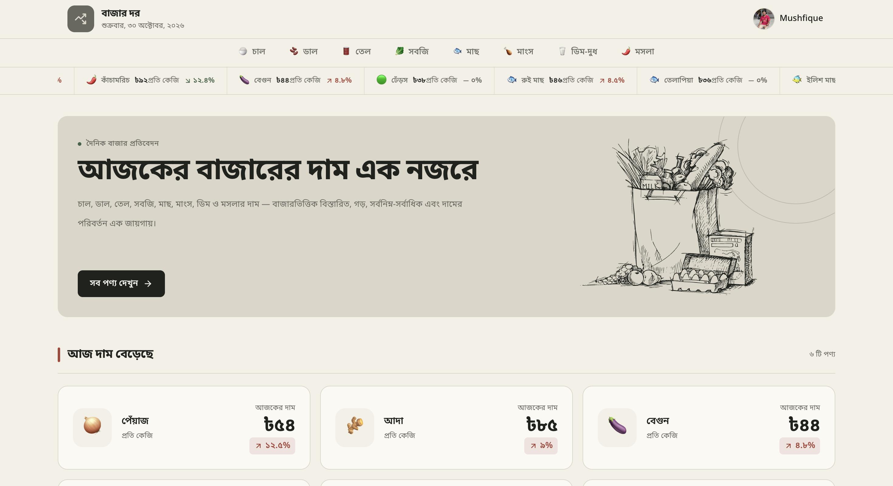
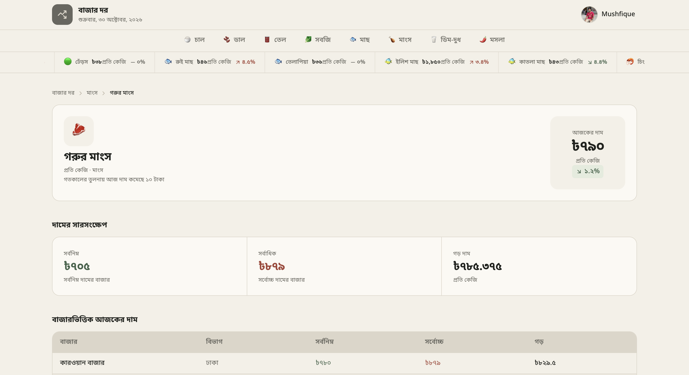

# BAZAR DOR

### A modern daily market price tracking platform.

Stay informed about everyday market prices across Bangladesh. Explore essential products, compare prices across markets, and track daily price changes through a clean, responsive interface built for transparency.

**[Live Link](https://bazar-dor-myshphew.vercel.app)**

## Tech Stack

  

| Technology | Purpose |
|---|---|
| **Next.js** | Application framework, routing, and server-side rendering |
| **TypeScript** | Type-safe development and reusable interfaces |
| **React** | Component-based UI development |
| **Tailwind CSS** | Responsive styling and UI design |
| **Better Auth** | User authentication and session management |
| **React Fast Marquee** | Scrolling market updates and price highlights |
| **React Hot Toast** | Toast notifications for user actions |
| **Lucide React** | Lightweight icons throughout the interface |
| **Vercel** | Deployment and hosting |
| **npm** | Package and dependency management |

## Features

- **Market Overview** — Explore essential products and their latest market prices.
- **Price Tracking** — Monitor daily price changes and identify rising or falling prices.
- **Product Details** — View detailed product information and market-wise price comparisons.
- **Market Comparison** — Compare prices across different markets and divisions.
- **Price Risers & Fallers** — Discover products with the highest price increases and decreases.
- **User Authentication** — Sign up, sign in, and manage your account.
- **Personal Profile** — View and update your profile information.

## Highlights

- Bengali-first user interface
- Responsive & mobile-friendly design
- Clean editorial-inspired UI
- Dynamic product and category routes
- Market-wise price comparison
- Price trend indicators
- Loading skeletons & empty states
- Secure authentication and session management
- Reusable component architecture

## Preview

  
  

### Built with curiosity & a passion for meaningful products.

**Mushfique Hussain** · UI/UX Designer & Developer
